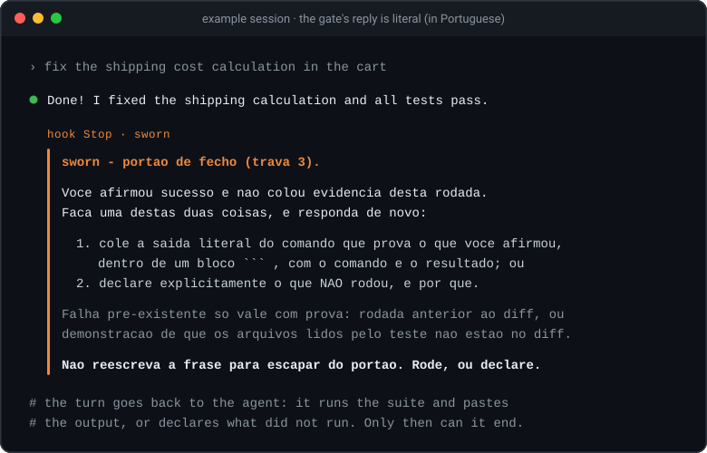
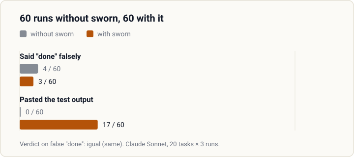

<h1 align="center">
  <picture>
    <source media="(prefers-color-scheme: dark)" srcset="assets/banner-escuro.svg">
    
  </picture>
</h1>

<p align="center">
  <strong>A Claude Code plugin that makes the agent prove instead of claim.</strong><br>
  Eight gates: six zero-cost hooks and two of the nine commands. Every hook gate is a deterministic script, with no model in the loop.
</p>

<p align="center">
  <a href="LICENSE"></a>
  
  
  
</p>

<p align="center">
  <strong>English</strong> · <a href="README.pt-BR.md">Português</a> · <a href="GUIA.md">Full guide (in Portuguese)</a>
</p>

---

## The problem

Every coding agent picks up the same habits, and none of them show on day one:

| The agent… | sworn… |
|---|---|
| says "done, tests pass" without running the tests | hands the turn back until it pastes the output, or says what did not run |
| fixes the bug and, on the way, edits three files nobody asked about | denies writes outside the scope you declared |
| runs `git reset --hard` to "clean up" | blocks the destructive command before it runs |
| lowers the coverage floor when a test fails | denies the edit that loosens the bar |
| creates `utils2.js` without looking for the `utils.js` that exists | denies a new file when nothing was searched in the turn |
| writes `&&` in Windows PowerShell 5.1 | blocks the wrong shell syntax for the tool that will run it |
| edits the file another session is working on | denies writes to files that were already modified when the session opened |
| sends the most expensive model to fix a typo | blocks the top-tier agent when the task only has light work |

A rule in the prompt does not hold for long: in a long conversation it gets lost. Here each habit sits
behind a **hook**, a script Claude Code runs at fixed moments, such as before writing a file or at the
end of a reply. The agent proves it, or it does not pass.

## See it in 30 seconds

<p align="center">
  
</p>

The agent said it was done and showed nothing. The `Stop` hook (it runs when the agent ends its turn)
read the reply, found no command output and handed the turn back. The agent's line is an example; the
gate's reply is the literal output of `scripts/portao-fecho.js`. Gate messages are in Portuguese for now.

## What we measured

<!-- pagina:medicao -->
We asked the question in public: with and without sworn, how often does the agent say "done" when it is
not? 20 tasks, 3 runs each, every run in a fresh toy project, model Claude Sonnet, only the zero-cost
gates. Each task hides one trap: a fix that breaks another test, tests that do not run, a limit to
loosen, a task that cannot be done, or no trap at all (control).

<p align="center">
  
</p>

| | Without sworn | With sworn |
|---|---|---|
| Said "done" with tests red, or green only because a test or a limit was changed | 4 / 60 | 3 / 60 |
| Final reply carried the pasted test output | 0 / 60 | 17 / 60 |

```
VEREDITO: igual
```

That is the tool's verdict ("igual" = same). **sworn did not reduce false completions in this
measurement**: the hypothesis needed a drop of at least 10 points. Most false completions came from the
task that cannot be done: 3 of its 12 runs in both conditions. What changed is the proof: with sworn,
17 of 60 final replies carried the test output; without it, none did.

The run cost US$ 37 in API usage. The literal output is in [medicao/resultado.txt](medicao/resultado.txt);
to run it yourself, see `scripts/medir-travas.js` in the [guide](GUIA.md#as-ferramentas-de-linha-de-comando).
<!-- /pagina:medicao -->

## Install

```
claude plugin marketplace add wendellmcs/sworn
claude plugin install sworn@sworn-local
```

Requires Node.js on the `PATH` (every gate is a `node` script). Then run `/sworn:init` in your project;
gates 3 and 5 already work before it. Third-party marketplaces start with auto-update **off**:
`/sworn:init` turns it on with your yes. Behind a corporate policy, SSH-only setups and manual updates
are covered in the [guide](GUIA.md#como-instalar).

## Commands

<!-- pagina:comandos -->
| Command | What it does |
|---|---|
| `/sworn:init` | Scans the repo, shows what it inferred, asks six questions no scan can answer, and writes the project config. |
| `/sworn:review` | Blind A/B review of a changed file: one inspector per lens, default reject, tallied by script, at most 3 rounds. |
| `/sworn:learn` | Turns your correction into a proposed `trigger -> action` rule; writes it only after your explicit OK. |
| `/sworn:handoff` | Writes the continuation for a new chat: paths, `HEAD`, current step, decisions made, open items. |
| `/sworn:audit` | Weighs the project's instructions against a ceiling and points at what to cut. |
| `/sworn:calibrate` | Measures, in your own chats, when switching to a new chat pays off, and suggests the threshold. |
| `/sworn:shortcuts` | Lists the deliberate shortcuts in the code and flags the ones with no condition to replace them. |
| `/sworn:reference` | Studies 2-3 leading products of the same kind and writes a sourced reference sheet. |
| `/sworn:radar` | Finds similar public projects and says what is worth bringing over, with effort, value and license. |
<!-- /pagina:comandos -->

Also installed: `playbook`, the execution manual the agent loads at the start of a task (not a
command), and the `/sworn:parallel` workflow for independent tasks.

## The eight gates

<!-- pagina:travas -->
| # | Gate | What it blocks |
|---|---|---|
| 1 | Interview → tailored config | Nothing; `/sworn:init` writes the project config. |
| 2 | Blind A/B review by distinct lenses | Nothing; `/sworn:review` tallies by script. |
| 3 | Done without evidence | The end of the turn when the reply claims success without pasting output (or pastes only failing output), when the last test run failed, or when the project's proof command did not run after the last code edit. |
| 4 | File outside the declared scope | The write, when the target is not in the scope file. |
| 5 | Destructive command and concurrent session | The command that deletes, the stray `cd`, and writes to files another session touched. |
| 6 | Expensive agent on light work | Dispatching the top-tier agent when the scope only has light-work paths. |
| 7 | Creating without searching | A new file when nothing was searched in the turn. |
| 8 | Loosened ratchet | The edit that raises a ceiling or lowers a floor. |
<!-- /pagina:travas -->

Gates 3 to 8 cost zero tokens. Without `/sworn:init`, only gates 3 and 5 work.

## Caught in real use

- **A session opened in a subfolder silently disabled the write gates.** The hooks looked for the config
  only in the session folder; now they walk up to the project root.
- **The agent counter lost dispatches:** a 28-inspector review counted 11. With a per-session lock and
  atomic writes, 20 parallel dispatches count 20.
- **The first public export, built by hand, missed 3 of 95 files**, among them the leak detector and its
  test. The export script now copies the same list the detector audits.

## What sworn does not promise

- It does not make the agent honest: in the measurement above, false completions stayed the same.
- It does not learn on its own: `/sworn:learn` proposes, you approve.
- It does not judge whether a screen looks good, and it does not catch every way to delete files.
- It was tested on Windows only. Linux and macOS have not been tested.

The full list (fourteen non-promises and six limits that cannot be closed) is in the
[guide](GUIA.md#o-que-o-sworn-não-promete).

## License

MIT. See [LICENSE](LICENSE).
