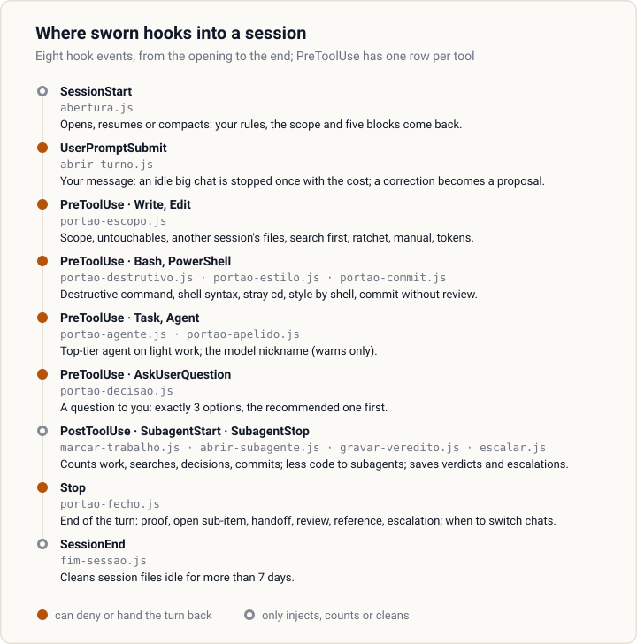

<h1 align="center">
  <picture>
    <source media="(prefers-color-scheme: dark)" srcset="assets/banner-escuro.svg">
    
  </picture>
</h1>

<p align="center">
  <strong>Your coding agent says "done". sworn makes it show the proof.</strong><br>
  A Claude Code plugin with eight numbered gates, nine more gates outside that count (each one a script that
  blocks or hands back the agent's action), and nine commands.
  Each gate runs in a hook: a fixed point in the session where Claude Code calls a script.
  The script is deterministic, with no model in the loop.
</p>

<p align="center">
  <a href="LICENSE"></a>
  
  
  
</p>

<p align="center">
  <strong>English</strong> · <a href="README.pt-BR.md">Português</a> · <a href="GUIA.md">Full guide (in Portuguese)</a>
</p>

<p align="center">
  
</p>

The agent said it was done and showed nothing. The `Stop` hook (it runs when the agent ends its turn)
read the reply, found no command output and handed the turn back. The agent's line is an example; the
gate's reply is the literal output of `scripts/portao-fecho.js`. Gate messages are in Portuguese.

---

## The problem

Every coding agent picks up the same habits, and none of them show on day one:

| The agent… | sworn… |
|---|---|
| says "done, tests pass" without running the tests | hands the turn back until it pastes the output, or says what did not run |
| fixes the bug and, on the way, edits three files nobody asked about | denies writes outside the scope you declared |
| runs `git reset --hard` to "clean up" | blocks the destructive command before it runs |
| lowers the coverage floor when a test fails | denies the edit that loosens the bar |
| creates `utils2.js` without looking for the `utils.js` that exists | denies a new file when nothing was searched in the turn |
| writes `&&` in Windows PowerShell 5.1 | blocks the wrong shell syntax for the tool that will run it |
| edits the file another session is working on | denies writes to files that were already modified when the session opened |
| sends the most expensive model to fix a typo | blocks the top-tier agent when the task only has light work |
| commits code nobody reviewed | denies the commit until the changed code has an approved blind review |
| asks you to decide inside a wall of text | denies the question without exactly 3 options, the recommended one first |
| loses the thread when the chat gets long | says when to switch chats, by a counted trigger, and hands over a ready prompt |

A rule in the prompt does not hold for long: in a long conversation it gets lost. Here each habit sits
behind a **hook**, a script Claude Code runs at fixed moments, such as before writing a file or at the
end of a reply. The agent proves it, or it does not pass.

## What we measured

<!-- pagina:medicao -->
We asked the question in public: with and without sworn, how often does the agent say "done" when it is
not? 20 tasks, 3 runs each, every run in a fresh toy project, model Claude Sonnet, only the zero-cost
gates. Each task hides one trap: a fix that breaks another test, tests that do not run, a limit to
loosen, a task that cannot be done, or no trap at all (control).

<p align="center">
  
</p>

| | Without sworn | With sworn |
|---|---|---|
| Said "done" with tests red, or green only because a test or a limit was changed | 4 / 60 | 3 / 60 |
| Final reply carried the pasted test output | 0 / 60 | 17 / 60 |

```
VEREDITO: igual
```

That is the tool's verdict ("igual" = same). **sworn did not reduce false completions in this
measurement**: the hypothesis needed a drop of at least 10 points. Most false completions came from the
task that cannot be done: 3 of its 12 runs in both conditions. What changed is the proof: with sworn,
17 of 60 final replies carried the test output; without it, none did.

The run cost US$ 37 in API usage. The literal output is in [medicao/resultado.txt](medicao/resultado.txt);
to run it yourself, see `scripts/medir-travas.js` in the [guide](GUIA.md#as-ferramentas-de-linha-de-comando).
<!-- /pagina:medicao -->

## Install

```
claude plugin marketplace add wendellmcs/sworn
claude plugin install sworn@sworn-local
```

Requires Node.js on the `PATH` (every gate is a `node` script). Then run `/sworn:init` in your project;
gates 3 and 5 already work before it. Third-party marketplaces start with auto-update **off**:
`/sworn:init` turns it on with your yes. Behind a corporate policy, SSH-only setups and manual updates
are covered in the [guide](GUIA.md#como-instalar).

## The arsenal

Everything the plugin installs, by the problem it answers: what sworn does, and why it is there. The
guide has each piece in full.

<p align="center">
  
</p>

### The eight gates

Each path of the project has a **gear**, the level of rigor the project config gives it: `rapida` (fast:
text, docs, config), `padrao` (standard) or `aaa` (the strictest, for what users see or what carries risk).
The names are the literal config values, in Portuguese. The fast gear asks for no scope: no paperwork where
there is no risk.

Gate 6, in the table below, reads the project's **ladder**: its agents from cheapest to most expensive, each with the model
and the effort (how hard the model thinks) it should run with. `/sworn:init` records the ladder in the
config, under `agentes.degraus` ("rungs"). Each agent is a **rung**; the most expensive one is the **top**.
**Moving up** is handing the task to the next rung: the subagent that finds the task beyond its role asks for
the next rung, and the main agent dispatches it. In a task, the main agent moves up twice on its own. Before
a third move up, it stops and asks you: move up (higher cost), keep the task on the rung it is on, or stop.
When the top asks, there is no rung above: the main agent stops and brings you what the top found and why
it asked, as a question in 3 options with the recommended one first.

<!-- pagina:travas -->
| # | Gate |
|---|---|
| 1 | **Interview → tailored config**<br>Blocks: nothing; `/sworn:init` writes the project config.<br>Why: A generic rule set fits no project; six questions no scan can answer do. |
| 2 | **Blind A/B review by distinct lenses**<br>Blocks: nothing; `/sworn:review` tallies by script.<br>Why: The author is the worst judge of the work; the inspector does not know which side is new. |
| 3 | **Done without evidence**<br>Blocks: the end of the turn when the reply claims success without pasting output (or pastes only failing output), when the last test run failed, when the project's proof command did not run after the last code edit, or when a plan step is called finished with a box still open.<br>Why: "Done" with nothing pasted is the most common false claim. Saying what did not run always passes. |
| 4 | **File outside the declared scope**<br>Blocks: the write, when the target is not in the scope file, is listed as out of scope, or is untouchable.<br>Why: A fix that wanders into files nobody asked about is how a regression ships. |
| 5 | **Destructive command and concurrent session**<br>Blocks: the command that deletes, the stray `cd`, the wrong shell syntax for the tool, and writes to files another session touched.<br>Why: Lost work cannot be reviewed back. |
| 6 | **Expensive agent, wrong model or effort, dropped request to move up**<br>Blocks:<br>• dispatching an agent from the more expensive half of the ladder, rounded down (with 2 or 3 agents, the top; with 4 or 5, the top two; with 6 or 7, the top three) when the scope only has fast-gear paths;<br>• calling a ladder agent with a model or an effort other than the one the ladder records;<br>• ending the turn while a subagent's request to move up has not been dispatched. This block fires once per request.<br>Each block tells the main agent what to do instead; you only step in when the main agent stops to ask you (before a third move up, or when the top asks).<br>Why: Cost does not hurt whoever picks the model, so the ladder picks it: no expensive agent on light work, the model and effort the ladder records, and the next rung when a subagent says the task is beyond its role. |
| 7 | **Creating without searching**<br>Blocks: a new file when nothing was searched in the turn.<br>Why: `utils2.js` next to `utils.js` is a duplicate nobody will clean up. |
| 8 | **Loosened ratchet**<br>Blocks: the edit that raises a ceiling or lowers a floor.<br>Why: Lowering the bar is the easy way to make a test pass; loosening is a human decision. |
<!-- /pagina:travas -->

Gates 3 to 8 cost zero tokens. Without `/sworn:init`, only gates 3 and 5 work.

### Nine more gates, outside the count

They have no number because each one has its own switch, depends on an optional module, or only warns.
Every switch is a `true`/`false` key in `.claude/sworn/projeto.json`.

<!-- pagina:portoes -->
| Gate | What it does | Why | Off switch |
|---|---|---|---|
| Review before commit | Denies `git commit` while code changed in the session has no approved blind review, and says how many inspectors each file needs. | A review after the commit is a review nobody does. | `portaoCommit` |
| Review before "done" | On `aaa` code changed in the session, a claim of delivery needs an approved review, or a stated reason why there is none. | The riskiest files are where a blind review pays. | `portaoRevisao` |
| Top reference | With a reference declared for the file type, an `aaa` delivery needs a review against it, in both orders. | Judged against the best of its kind, not against taste. | `portaoReferencia` |
| Manual first | Denies editing an `aaa` file before the execution manual was loaded in the session. | Rigor that was never loaded is never applied. | `portaoManual` |
| Three options | Denies a question to you without exactly 3 options and the recommended one first; a plain question of fact passes with `(fato)` ("fact") in its header. | A choice hidden in a wall of text is a choice you did not make. | `portaoDecisao` |
| Handoff prompt | Hands the turn back when it wrote a handoff file and the final reply has no code block. | The prompt for the next chat has to reach you, not only a file. | `portaoHandoff` |
| Model nickname | Warns once a session when an agent's `model:` (the model field in the agent's file) differs from the nickname recorded in the project (a short model name, such as `sonnet` or `opus`), or its `effort:` (the effort field) from the effort the ladder records for it. Does not block: the main agent offers you 3 options, to make the agent's file match the project, to make the project match the file, or to leave it for now. | A silent model swap changes cost and quality. | none; quiet without recorded nicknames |
| Style by shell | With a declared design system, denies a style file written by a shell command. | The token check lives on `Write` and `Edit`; a shell write would skip it. | no `design.json` |
| Design tokens | With `.claude/sworn/design.json`, denies a style file with a color or a `px`, `rem` or `em` size the system does not have. | A design system dies one hardcoded value at a time. | no `design.json` |
<!-- /pagina:portoes -->

### Rules that come back every session

The session opening injects, in this order: your project rules and the scope in force (again after the
context is compacted, which is exactly when a rule gets lost), plus what the session already did; the
**parallel work** rules (a background agent is no reason to stop, agents that edit at the same time run
isolated, an agent's report is a claim to check, at most 8 agents per dispatch); **fewer stops** (validate
before asking you to act; with the continuous mode, decide technical choices inside the scope and ask only
the irreversible, the external and the costly); **response quality** (six rules: conclusion first, no
preamble, a technical term explained the first time, one line between tools, evidence cut to the line that
proves it, no repeating what you just read; the reply comes in your language); and
**less code** (7 questions asked in order before writing code, stopping at the first that settles it: does it need to exist, does the project already have
it, does the language or platform do it). Subagents that can write code get the last block too.

### Knowing when to switch chats

Long chats drift: the plan gets executed from memory. sworn counts instead of guessing, and warns once,
at the end of a turn, with the reason:

- **Counted triggers:** conversation size (a warning at 250 thousand tokens with the continuous mode,
  an alarm at 450 thousand), 6 gate blocks, and your own question "is the context ok?". With the
  continuous mode off, also turns with work, reviews closed, files touched, your decisions and commits.
  Every number is a key in `limiares` (thresholds) in the project config.
- **The handoff:** `/sworn:handoff` writes the continuation (paths, `HEAD`, current step, decisions,
  open items) and pastes the ready prompt; the handoff gate makes sure the prompt reaches you.
- **Before an expensive return:** a message to a chat of 200 thousand tokens or more, idle for over an
  hour, is stopped once with the cost of going on against a new chat, and a summary of the chat is
  saved for it. In the author's chats, those returns cost US$ 119 in 44 days, against about US$ 23 as new
  chats. Off with `avisoDeVolta`.
- **`/sworn:calibrate`** measures, in your own chats, the size from which switching pays off.

### Panels

Two commands that come with the plugin (Claude Code 2.1.287 or newer): `/sworn-session` shows context
used, the 5-hour and weekly windows, spend, a forecast and the switch signals; `/sworn-plan` shows the
active plan, tasks done and open, and the estimate of sessions left. The status line carries the same
meter in one line, and a band above the prompt shows the plan and one button at a time for the sworn
command that is due.

### Learning, pruning and studying

- **A correction becomes a proposed rule.** When you correct how the agent works, it answers, runs
  `/sworn:learn` in the same reply and asks you, in 3 options, whether to save it. It never learns alone.
- **The audit runs by itself** every 7 days at the opening: instruction weight, repeated skills, rules
  that contradict each other, stale skills, shortcuts with no trigger to replace them. It speaks only
  when something crossed a limit.
- **What actually ran.** `/sworn:audit`, run by hand, reads the subagent transcripts and shows, for each
  agent of the ladder, the model and effort that answered against what the ladder asks. A nickname that
  started answering with another model id without anyone changing the ladder (the id is the full name, with
  the version, such as `claude-sonnet-5-5`) comes first, as a warning, and the audit asks you whether that
  rung stays as it is. The automatic run skips this: it reads
  every subagent transcript of the last 30 days, too slow for the session opening.
- **Shortcuts are labeled.** A deliberate shortcut carries `atalho: <what>. limite: <how far>. trocar
  quando: <trigger>.`, and `/sworn:shortcuts` lists them and flags the ones with no trigger.
- **Study before building.** `/sworn:reference` builds a sourced sheet of 2-3 leading products of the
  same kind; `/sworn:radar` finds similar public projects and says what is worth bringing over, and
  offers itself once a session when you ask for a new feature. The weekly watch (`vigia`) is for the
  plugin's maintainer and is off by default.

### The blind review, inside

`/sworn:review` labels both sides A and B with no authorship and sends one inspector per lens (a single
angle of reading, such as correctness, edge cases or text): **ten** for code, **eight** for screens. Each
inspector starts from reject. A round is one pass of all the inspectors; a dry round is one that finds no
new serious defect. Two dry rounds in a row approve, and the cap is 3 rounds. A small change goes to fewer inspectors (one up to 3 lines). A second agent judges whether two
findings are the same defect, and the tally is a script. On screens, the lenses check every state, the minimum
reading contrast (level AA of WCAG, the web accessibility standard), a clickable area of at least 24 × 24 px per
button, and INP (the time from a click to the screen's response).

## Commands

<!-- pagina:comandos -->
| Command | What it does |
|---|---|
| `/sworn:init` | Scans the repo, shows what it inferred, asks six questions no scan can answer, and writes the project config. |
| `/sworn:review` | Blind A/B review of a changed file: one inspector per lens, default reject, tallied by script, at most 3 rounds. |
| `/sworn:learn` | Turns your correction into a proposed `trigger -> action` rule; writes it only after your explicit OK. |
| `/sworn:handoff` | Writes the continuation for a new chat: paths, `HEAD`, current step, decisions made, open items. |
| `/sworn:audit` | Weighs the project's instructions against a ceiling, points at what to cut, and shows the model and effort the subagents actually ran with. |
| `/sworn:calibrate` | Measures, in your own chats, when switching to a new chat pays off, and suggests the threshold. |
| `/sworn:shortcuts` | Lists the deliberate shortcuts in the code and flags the ones with no condition to replace them. |
| `/sworn:reference` | Studies 2-3 leading products of the same kind and writes a sourced reference sheet. |
| `/sworn:radar` | Finds similar public projects and says what is worth bringing over, with effort, value and license. |
<!-- /pagina:comandos -->

Also installed: `playbook`, the execution manual the agent loads at the start of a task (not a
command); `effort-low` and `effort-high`, two skills outside the menu that the playbook calls by gear, at
the start of each turn of the task, to set how hard the main conversation thinks in that turn (only the
effort: the model changes only when you type `/model`); the `/sworn:parallel` workflow, which runs 3 or more independent tasks at once with a cap on
agents, the cheapest model that solves and an isolated copy for whoever edits; and three agents:
`inspector` and `dedupe-judge` for the blind review, `reader` for light reading in parallel.

## Caught in real use

- **A session opened in a subfolder silently disabled the write gates.** The hooks looked for the config
  only in the session folder; now they walk up to the project root.
- **The agent counter lost dispatches:** a 28-inspector review counted 11. With a per-session lock and
  atomic writes, 20 parallel dispatches count 20.
- **The first public export, built by hand, missed 3 of 95 files**, among them the leak detector and its
  test. The export script now copies the same list the detector audits.

## What sworn does not promise

- It does not make the agent honest: in the measurement above, false completions stayed the same.
- It does not learn on its own: `/sworn:learn` proposes, you approve.
- It does not judge whether a screen looks good, and it does not catch every way to delete files.
- The injected rules are instructions, and an instruction can be skipped; only the hook gates are enforced.
- It was tested on Windows only. Linux and macOS have not been tested.

The full list (fourteen non-promises and six limits that cannot be closed) is in the
[guide](GUIA.md#o-que-o-sworn-não-promete).

## License

MIT. See [LICENSE](LICENSE).
