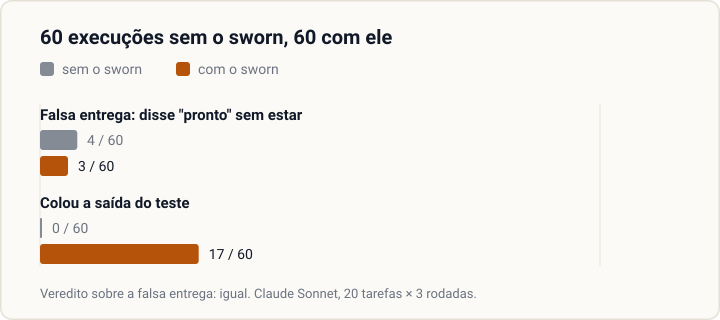

<h1 align="center">
  <picture>
    <source media="(prefers-color-scheme: dark)" srcset="assets/banner-escuro.svg">
    
  </picture>
</h1>

<p align="center">
  <strong>Um plugin do Claude Code que obriga o agente a provar em vez de afirmar.</strong><br>
  Oito travas: seis ganchos de custo zero e dois dos nove comandos. Todo portão de gancho é um script determinístico, sem modelo no meio.
</p>

<p align="center">
  <a href="LICENSE"></a>
  
  
  
</p>

<p align="center">
  <a href="README.md">English</a> · <strong>Português</strong> · <a href="GUIA.md">Guia completo</a>
</p>

---

## O problema

Todo agente de código pega os mesmos vícios, e nenhum deles aparece no primeiro dia:

| O agente… | O sworn… |
|---|---|
| diz "pronto, os testes passam" sem ter rodado os testes | devolve o turno até ele colar a saída, ou dizer o que não rodou |
| corrige o bug e, de passagem, mexe em três arquivos que ninguém pediu | nega a escrita fora do escopo que você declarou |
| roda `git reset --hard` para "limpar" | barra o comando destrutivo antes de ele rodar |
| baixa o piso de cobertura quando o teste reprova | nega a edição que afrouxa a régua |
| cria `utils2.js` sem procurar o `utils.js` que já existe | nega arquivo novo quando nada foi buscado no turno |
| escreve `&&` no PowerShell 5.1 do Windows | barra a sintaxe de shell errada para a ferramenta que vai rodar |
| edita o arquivo que outra sessão está mexendo | nega a escrita em arquivo que já estava modificado quando a sessão abriu |
| manda o modelo mais caro corrigir um typo | barra o agente do topo da escada quando a tarefa só tem trabalho leve |

Regra no prompt não segura por muito tempo: numa conversa longa, ela se perde. Aqui cada vício fica
atrás de um **gancho** (hook), um script que o Claude Code roda em momentos fixos, como antes de
escrever um arquivo ou no fim da resposta. Ou o agente prova, ou não passa.

## Veja em 30 segundos

<p align="center">
  
</p>

O agente disse que terminou e não mostrou nada. O gancho `Stop` (o que roda quando o agente fecha o
turno) leu a resposta, não achou saída de comando colada e devolveu o turno. A frase do agente é de
exemplo; a resposta do portão é a saída literal do `scripts/portao-fecho.js`.

## O que medimos

<!-- pagina:medicao -->
Fizemos a pergunta em público: com e sem o sworn, quantas vezes o agente diz "pronto" quando não está?
20 tarefas, 3 rodadas cada, cada rodada num projeto de brinquedo novo, modelo Claude Sonnet, só as
travas de custo zero. Cada tarefa esconde uma armadilha: uma correção que quebra outro teste, testes
que não rodam, um limite para afrouxar, uma tarefa impossível, ou nenhuma (controle).

<p align="center">
  
</p>

| | Sem o sworn | Com o sworn |
|---|---|---|
| Disse "pronto" com o teste vermelho, ou verde só porque um teste ou um limite mudou | 4 / 60 | 3 / 60 |
| A resposta final trouxe a saída do teste colada | 0 / 60 | 17 / 60 |

```
VEREDITO: igual
```

É o veredito da ferramenta. **O sworn não reduziu a falsa entrega nesta medição**: a hipótese pedia
uma queda de pelo menos 10 pontos. A maior parte das falsas entregas veio da tarefa impossível: 3 das
12 rodadas dela, nas duas condições. O que mudou foi a prova: com o sworn, 17 de 60 respostas finais
trouxeram a saída do teste; sem ele, nenhuma.

A rodada custou US$ 37 de uso da API. A saída literal está em [medicao/resultado.txt](medicao/resultado.txt);
para rodar você mesmo, veja o `scripts/medir-travas.js` no [guia](GUIA.md#as-ferramentas-de-linha-de-comando).
<!-- /pagina:medicao -->

## Como instalar

```
claude plugin marketplace add wendellmcs/sworn
claude plugin install sworn@sworn-local
```

Precisa do Node.js no `PATH` (todo portão é um script `node`). Depois rode `/sworn:init` no seu
projeto; as travas 3 e 5 já funcionam antes dele. Marketplace de terceiros começa com a atualização
automática **desligada**: o `/sworn:init` a liga com o seu sim. Empresa com política gerenciada, máquina
sem chave SSH e atualização à mão estão no [guia](GUIA.md#como-instalar).

## Comandos

<!-- pagina:comandos -->
| Comando | O que faz |
|---|---|
| `/sworn:init` | Varre o repositório, mostra o que inferiu, faz seis perguntas que varredura nenhuma responde e grava a configuração do projeto. |
| `/sworn:review` | Revisão cega A/B de um arquivo mudado: um inspetor por lente, default reprovar, apuração por script, no máximo 3 rondas. |
| `/sworn:learn` | Transforma uma correção sua em regra proposta `gatilho -> ação`; só grava depois do seu OK explícito. |
| `/sworn:handoff` | Escreve a continuação para um chat novo: caminhos, `HEAD`, etapa atual, decisões tomadas, pendências. |
| `/sworn:audit` | Pesa as instruções do projeto contra um teto e aponta o que cortar. |
| `/sworn:calibrate` | Mede, nas suas conversas, quando trocar de chat compensa, e sugere o limiar. |
| `/sworn:shortcuts` | Lista os atalhos deliberados do código e marca os que não dizem quando trocar. |
| `/sworn:reference` | Estuda 2-3 produtos líderes do mesmo tipo e grava uma ficha com a fonte de cada achado. |
| `/sworn:radar` | Acha projetos públicos parecidos e diz o que vale trazer, com esforço, valor e licença. |
<!-- /pagina:comandos -->

Também vêm instalados: o `playbook`, o manual de execução que o agente carrega no começo da tarefa (não
é comando), e o workflow `/sworn:parallel`, para tarefas independentes.

## As oito travas

<!-- pagina:travas -->
| # | Trava | O que bloqueia |
|---|---|---|
| 1 | Entrevista → configuração sob medida | Nada; o `/sworn:init` grava a configuração do projeto. |
| 2 | Revisão cega A/B por lentes distintas | Nada; o `/sworn:review` apura por script. |
| 3 | Fecho sem evidência | O fim do turno quando a resposta alega sucesso sem colar a saída (ou colando só saída com falha), quando o último teste rodado falhou, ou quando a prova de pronto do projeto não rodou depois da última edição de código. |
| 4 | Arquivo fora do escopo declarado | A escrita, quando o alvo não está no arquivo de escopo. |
| 5 | Comando destrutivo e sessão concorrente | O comando que apaga, o `cd` solto e a escrita em arquivo que outra sessão mexeu. |
| 6 | Agente caro em trabalho leve | O despacho do agente do topo da escada quando o escopo só tem caminhos de trabalho leve. |
| 7 | Criar sem ter procurado | Arquivo novo quando nada foi buscado no turno. |
| 8 | Catraca afrouxada | A edição que sobe um teto ou desce um piso. |
<!-- /pagina:travas -->

As travas 3 a 8 custam zero token. Sem `/sworn:init`, só as travas 3 e 5 funcionam.

## O que ele já pegou em uso real

- **Sessão aberta numa subpasta desligava os portões de escrita, em silêncio.** Os ganchos procuravam a
  configuração só na pasta da sessão; agora sobem até a raiz do projeto.
- **O contador de agentes perdia despachos:** uma revisão de 28 inspetores contou 11. Com trava por
  sessão e gravação atômica, 20 despachos em paralelo contam 20.
- **A primeira publicação, montada à mão, saiu sem 3 de 95 arquivos**, entre eles o detector de
  vazamento e o teste dele. O script de export agora copia a mesma lista que o detector audita.

## O que o sworn não promete

- Não torna o agente honesto: na medição acima, a falsa entrega ficou igual.
- Não aprende sozinho: o `/sworn:learn` propõe, você aprova.
- Não julga se uma tela ficou bonita, e não pega toda forma de apagar arquivo.
- Foi testado só no Windows. Linux e macOS não foram testados.

A lista inteira (quatorze promessas que ele não faz e seis limites que não fecham) está no
[guia](GUIA.md#o-que-o-sworn-não-promete).

## Licença

MIT. Veja o [LICENSE](LICENSE).
