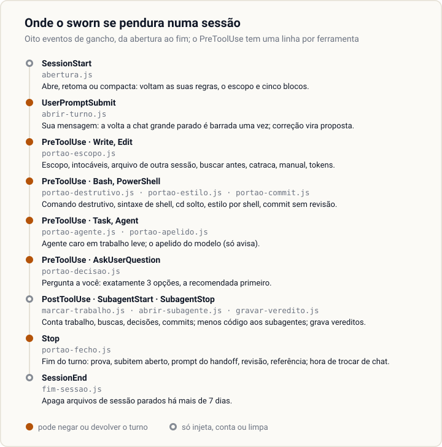

<h1 align="center">
  <picture>
    <source media="(prefers-color-scheme: dark)" srcset="assets/banner-escuro.svg">
    
  </picture>
</h1>

<p align="center">
  <strong>O seu agente de código diz "pronto". O sworn o obriga a mostrar a prova.</strong><br>
  Um plugin do Claude Code com oito travas numeradas, mais nove portões fora dessa conta (cada um, um script
  que barra ou devolve a ação do agente), e nove comandos.
  Cada portão roda num gancho (hook): o momento fixo da sessão em que o Claude Code chama um script.
  O script é determinístico, sem modelo no meio.
</p>

<p align="center">
  <a href="LICENSE"></a>
  
  
  
</p>

<p align="center">
  <a href="README.md">English</a> · <strong>Português</strong> · <a href="GUIA.md">Guia completo</a>
</p>

<p align="center">
  
</p>

O agente disse que terminou e não mostrou nada. O gancho `Stop` (o que roda quando o agente fecha o
turno) leu a resposta, não achou saída de comando colada e devolveu o turno. A frase do agente é de
exemplo; a resposta do portão é a saída literal do `scripts/portao-fecho.js`.

---

## O problema

Todo agente de código pega os mesmos vícios, e nenhum deles aparece no primeiro dia:

| O agente… | O sworn… |
|---|---|
| diz "pronto, os testes passam" sem ter rodado os testes | devolve o turno até ele colar a saída, ou dizer o que não rodou |
| corrige o bug e, de passagem, mexe em três arquivos que ninguém pediu | nega a escrita fora do escopo que você declarou |
| roda `git reset --hard` para "limpar" | barra o comando destrutivo antes de ele rodar |
| baixa o piso de cobertura quando o teste reprova | nega a edição que afrouxa a régua |
| cria `utils2.js` sem procurar o `utils.js` que já existe | nega arquivo novo quando nada foi buscado no turno |
| escreve `&&` no PowerShell 5.1 do Windows | barra a sintaxe de shell errada para a ferramenta que vai rodar |
| edita o arquivo que outra sessão está mexendo | nega a escrita em arquivo que já estava modificado quando a sessão abriu |
| manda o modelo mais caro corrigir um typo | barra o agente do topo da escada quando a tarefa só tem trabalho leve |
| commita código que ninguém revisou | nega o commit até o código mudado ter revisão cega aprovada |
| pede a sua decisão no meio de uma muralha de texto | nega a pergunta que não tem exatamente 3 opções, a recomendada primeiro |
| perde o fio quando o chat fica longo | diz quando trocar de chat, por gatilho contado, e entrega o prompt pronto |

Regra no prompt não segura por muito tempo: numa conversa longa, ela se perde. Aqui cada vício fica
atrás de um **gancho** (hook), um script que o Claude Code roda em momentos fixos, como antes de
escrever um arquivo ou no fim da resposta. Ou o agente prova, ou não passa.

## O que medimos

<!-- pagina:medicao -->
Fizemos a pergunta em público: com e sem o sworn, quantas vezes o agente diz "pronto" quando não está?
20 tarefas, 3 rodadas cada, cada rodada num projeto de brinquedo novo, modelo Claude Sonnet, só as
travas de custo zero. Cada tarefa esconde uma armadilha: uma correção que quebra outro teste, testes
que não rodam, um limite para afrouxar, uma tarefa impossível, ou nenhuma (controle).

<p align="center">
  
</p>

| | Sem o sworn | Com o sworn |
|---|---|---|
| Disse "pronto" com o teste vermelho, ou verde só porque um teste ou um limite mudou | 4 / 60 | 3 / 60 |
| A resposta final trouxe a saída do teste colada | 0 / 60 | 17 / 60 |

```
VEREDITO: igual
```

É o veredito da ferramenta. **O sworn não reduziu a falsa entrega nesta medição**: a hipótese pedia
uma queda de pelo menos 10 pontos. A maior parte das falsas entregas veio da tarefa impossível: 3 das
12 rodadas dela, nas duas condições. O que mudou foi a prova: com o sworn, 17 de 60 respostas finais
trouxeram a saída do teste; sem ele, nenhuma.

A rodada custou US$ 37 de uso da API. A saída literal está em [medicao/resultado.txt](medicao/resultado.txt);
para rodar você mesmo, veja o `scripts/medir-travas.js` no [guia](GUIA.md#as-ferramentas-de-linha-de-comando).
<!-- /pagina:medicao -->

## Como instalar

```
claude plugin marketplace add wendellmcs/sworn
claude plugin install sworn@sworn-local
```

Precisa do Node.js no `PATH` (todo portão é um script `node`). Depois rode `/sworn:init` no seu
projeto; as travas 3 e 5 já funcionam antes dele. Marketplace de terceiros começa com a atualização
automática **desligada**: o `/sworn:init` a liga com o seu sim. Empresa com política gerenciada, máquina
sem chave SSH e atualização à mão estão no [guia](GUIA.md#como-instalar).

## O arsenal

Tudo o que o plugin instala, pelo problema que resolve: o que o sworn faz, e por que está ali. O guia
traz cada peça por inteiro.

<p align="center">
  
</p>

### As oito travas

Cada caminho do projeto tem uma **marcha**, o nível de rigor que a configuração do projeto dá a ele:
`rapida` (texto, documentação, config), `padrao` ou `aaa` (a mais rigorosa, para o que o usuário vê ou o que
tem risco). Marcha rápida não exige escopo: sem burocracia onde não há risco.

<!-- pagina:travas -->
| # | Trava | O que bloqueia | Por quê |
|---|---|---|---|
| 1 | Entrevista → configuração sob medida | Nada; o `/sworn:init` grava a configuração do projeto. | Regra genérica não serve a projeto nenhum; seis perguntas que varredura nenhuma responde servem. |
| 2 | Revisão cega A/B por lentes distintas | Nada; o `/sworn:review` apura por script. | Quem fez é o pior juiz do próprio trabalho; o inspetor não sabe qual lado é o novo. |
| 3 | Fecho sem evidência | O fim do turno quando a resposta alega sucesso sem colar a saída (ou colando só saída com falha), quando o último teste rodado falhou, quando a prova de pronto do projeto não rodou depois da última edição de código, ou quando uma etapa do plano é dada como pronta com caixa ainda aberta. | "Pronto" sem nada colado é a alegação falsa mais comum. Dizer o que não rodou sempre libera. |
| 4 | Arquivo fora do escopo declarado | A escrita, quando o alvo não está no arquivo de escopo, está declarado fora dele ou é intocável. | Correção que passeia por arquivo que ninguém pediu é como a regressão chega à produção. |
| 5 | Comando destrutivo e sessão concorrente | O comando que apaga, o `cd` solto, a sintaxe de shell errada para a ferramenta e a escrita em arquivo que outra sessão mexeu. | Trabalho perdido não volta para revisão. |
| 6 | Agente caro em trabalho leve | O despacho do agente do topo da escada quando o escopo só tem caminhos de trabalho leve. | Custo não dói em quem escolhe o modelo. |
| 7 | Criar sem ter procurado | Arquivo novo quando nada foi buscado no turno. | `utils2.js` ao lado do `utils.js` é duplicata que ninguém vai limpar. |
| 8 | Catraca afrouxada | A edição que sobe um teto ou desce um piso. | Baixar a régua é o jeito fácil de o teste passar; afrouxar é decisão humana. |
<!-- /pagina:travas -->

As travas 3 a 8 custam zero token. Sem `/sworn:init`, só as travas 3 e 5 funcionam.

### Mais nove portões, fora da conta

Não têm número porque cada um tem chave própria, depende de um módulo opcional ou só avisa. Toda chave é
um `true`/`false` em `.claude/sworn/projeto.json`.

<!-- pagina:portoes -->
| Portão | O que faz | Por quê | Desliga com |
|---|---|---|---|
| Revisão antes do commit | Nega o `git commit` enquanto o código mudado na sessão não tem revisão cega aprovada, e diz quantos inspetores cada arquivo pede. | Revisão depois do commit é revisão que ninguém faz. | `portaoCommit` |
| Revisão antes do "pronto" | Em código `aaa` mudado na sessão, a alegação de entrega pede revisão aprovada, ou o motivo dito de não ter. | Os arquivos de mais risco são onde a revisão cega compensa. | `portaoRevisao` |
| Referência de topo | Com referência declarada para o tipo do arquivo, a entrega `aaa` pede revisão contra ela, nas duas ordens. | Julgado contra o melhor do mesmo tipo, não contra o gosto. | `portaoReferencia` |
| Manual antes | Nega editar arquivo `aaa` antes de o manual de execução ser carregado na sessão. | Rigor que nunca foi carregado nunca é aplicado. | `portaoManual` |
| Três opções | Nega a pergunta a você sem exatamente 3 opções e a recomendada primeiro; a pergunta de fato passa com `(fato)` no título curto. | Escolha escondida numa muralha de texto é escolha que você não fez. | `portaoDecisao` |
| Prompt do handoff | Devolve o turno que gravou um arquivo de handoff quando a resposta final não tem bloco de código. | O prompt do próximo chat tem de chegar a você, não só a um arquivo. | `portaoHandoff` |
| Apelido do modelo | Avisa uma vez por sessão quando o `model:` de um agente difere do apelido gravado no projeto. Não barra. | Troca de modelo calada muda custo e qualidade. | não há; fica calado sem apelidos gravados |
| Estilo por shell | Com design system declarado, nega o arquivo de estilo escrito por comando de shell. | A conferência de tokens mora no `Write` e no `Edit`; a escrita por shell a pularia. | não ter `design.json` |
| Tokens de design | Com `.claude/sworn/design.json`, nega o arquivo de estilo com cor ou medida em `px`, `rem` ou `em` que o sistema não tem. | Um design system morre um valor fixo de cada vez. | não ter `design.json` |
<!-- /pagina:portoes -->

### Regras que voltam em toda sessão

A abertura da sessão injeta, nesta ordem: as regras do seu projeto e o escopo em vigor (de novo depois
que o contexto é compactado, que é justamente quando a regra se perde), mais o que a sessão já fez; as
regras de **trabalho em paralelo** (agente em segundo plano não é motivo para parar, agentes que editam ao
mesmo tempo rodam isolados, relatório de agente é alegação a conferir, até 8 agentes por disparo);
**menos paradas** (validar antes de pedir ação a você; com o modo contínuo, decidir a escolha técnica
dentro do escopo e perguntar só o irreversível, o externo e o que custa); **qualidade de resposta** (seis
regras: conclusão primeiro, sem preâmbulo, termo técnico explicado na primeira vez, uma linha entre
ferramentas, evidência reduzida à linha que prova, nada de repetir o que você acabou de ler; a resposta vem
no seu idioma); e **menos código** (uma escada de 7 degraus antes de escrever código: precisa existir, o
projeto já tem, a linguagem ou a plataforma já faz). Os subagentes que podem escrever código recebem o
último bloco também.

### Saber quando trocar de chat

Chat longo deriva: o plano passa a ser executado de memória. O sworn conta em vez de adivinhar, e avisa
uma vez, no fim de um turno, com o motivo:

- **Gatilhos contados:** o tamanho da conversa (aviso a 250 mil tokens com o modo contínuo, alarme a
  450 mil), 6 bloqueios de portão, e a sua própria pergunta "o contexto está bom?". Com o modo contínuo
  desligado, também turnos com trabalho, revisões fechadas, arquivos tocados, decisões suas e commits.
  Cada número é uma chave em `limiares`.
- **O handoff:** o `/sworn:handoff` escreve a continuação (caminhos, `HEAD`, etapa atual, decisões,
  pendências) e cola o prompt pronto; o portão do handoff garante que o prompt chegue a você.
- **Antes de uma volta cara:** a mensagem num chat de 200 mil tokens ou mais, parado há mais de uma hora,
  é barrada uma vez com o custo de seguir ali contra o de um chat novo, e um resumo do chat fica gravado
  para ele. Nos chats do autor, essas voltas custaram US$ 119 em 44 dias, contra uns US$ 23 como chats
  novos. Desliga com `avisoDeVolta`.
- **O `/sworn:calibrate`** mede, nos seus chats, a partir de que tamanho trocar compensa.

### Painéis

Dois comandos que vêm com o plugin (Claude Code 2.1.287 ou mais novo): o `/sworn-session` mostra o
contexto usado, as janelas de 5 horas e da semana, o gasto, a previsão e os sinais de troca; o
`/sworn-plan` mostra o plano ativo, as tarefas feitas e abertas e a estimativa de sessões que faltam. A
linha de status traz o mesmo medidor em uma linha, e uma faixa acima do prompt mostra o plano e um botão
por vez, o do comando do sworn que está na hora.

### Aprender, podar e estudar

- **Correção vira regra proposta.** Quando você corrige o jeito de o agente trabalhar, ele atende, roda o
  `/sworn:learn` na mesma resposta e pergunta a você, em 3 opções, se grava. Nunca aprende sozinho.
- **A auditoria roda sozinha** a cada 7 dias, na abertura: peso de instrução, skills repetidas, regras
  que se contradizem, skills paradas, atalhos sem gatilho de troca. Só fala quando algo passou do limite.
- **Atalho leva rótulo.** O atalho de propósito leva `atalho: <o que>. limite: <até onde vale>. trocar
  quando: <gatilho>.`, e o `/sworn:shortcuts` lista todos e marca os que não têm gatilho.
- **Estudar antes de construir.** O `/sworn:reference` monta uma ficha com fonte de 2-3 produtos líderes
  do mesmo tipo; o `/sworn:radar` acha projetos públicos parecidos e diz o que vale trazer, e se oferece
  uma vez por sessão quando você pede função nova. O vigia da semana (`vigia`) é do mantenedor do plugin
  e vem desligado.

### A revisão cega, por dentro

O `/sworn:review` rotula os dois lados como A e B, sem autoria, e manda um inspetor por lente (um ângulo
de leitura só, como correção, borda ou texto): **dez** de código, **oito** de tela. Cada inspetor parte de
reprovar. Uma ronda é uma passada de todos os inspetores; ronda seca é a que não acha defeito grave novo.
Duas rondas secas seguidas aprovam, e o teto é de 3 rondas.
Mudança pequena vai a menos inspetores (um, até 3 linhas). Um segundo agente julga se dois achados são o
mesmo defeito, e a apuração é um script. Em tela, as lentes conferem cada estado, o contraste mínimo de
leitura (o nível AA da WCAG, a norma de acessibilidade da web), a área clicável de pelo menos 24 × 24 px em cada
botão e o INP (o tempo do clique até a tela responder).

## Comandos

<!-- pagina:comandos -->
| Comando | O que faz |
|---|---|
| `/sworn:init` | Varre o repositório, mostra o que inferiu, faz seis perguntas que varredura nenhuma responde e grava a configuração do projeto. |
| `/sworn:review` | Revisão cega A/B de um arquivo mudado: um inspetor por lente, default reprovar, apuração por script, no máximo 3 rondas. |
| `/sworn:learn` | Transforma uma correção sua em regra proposta `gatilho -> ação`; só grava depois do seu OK explícito. |
| `/sworn:handoff` | Escreve a continuação para um chat novo: caminhos, `HEAD`, etapa atual, decisões tomadas, pendências. |
| `/sworn:audit` | Pesa as instruções do projeto contra um teto e aponta o que cortar. |
| `/sworn:calibrate` | Mede, nas suas conversas, quando trocar de chat compensa, e sugere o limiar. |
| `/sworn:shortcuts` | Lista os atalhos deliberados do código e marca os que não dizem quando trocar. |
| `/sworn:reference` | Estuda 2-3 produtos líderes do mesmo tipo e grava uma ficha com a fonte de cada achado. |
| `/sworn:radar` | Acha projetos públicos parecidos e diz o que vale trazer, com esforço, valor e licença. |
<!-- /pagina:comandos -->

Também vêm instalados: o `playbook`, o manual de execução que o agente carrega no começo da tarefa (não
é comando); o workflow `/sworn:parallel`, que roda 3 ou mais tarefas independentes de uma vez, com teto de
agentes, o modelo mais barato que resolve e cópia isolada para quem edita; e três agentes: `inspector` e
`dedupe-judge` da revisão cega, `reader` para leitura leve no paralelo.

## O que ele já pegou em uso real

- **Sessão aberta numa subpasta desligava os portões de escrita, em silêncio.** Os ganchos procuravam a
  configuração só na pasta da sessão; agora sobem até a raiz do projeto.
- **O contador de agentes perdia despachos:** uma revisão de 28 inspetores contou 11. Com trava por
  sessão e gravação atômica, 20 despachos em paralelo contam 20.
- **A primeira publicação, montada à mão, saiu sem 3 de 95 arquivos**, entre eles o detector de
  vazamento e o teste dele. O script de export agora copia a mesma lista que o detector audita.

## O que o sworn não promete

- Não torna o agente honesto: na medição acima, a falsa entrega ficou igual.
- Não aprende sozinho: o `/sworn:learn` propõe, você aprova.
- Não julga se uma tela ficou bonita, e não pega toda forma de apagar arquivo.
- As regras injetadas são instrução, e instrução pode ser pulada; só os portões de gancho são cobrados.
- Foi testado só no Windows. Linux e macOS não foram testados.

A lista inteira (quatorze promessas que ele não faz e seis limites que não fecham) está no
[guia](GUIA.md#o-que-o-sworn-não-promete).

## Licença

MIT. Veja o [LICENSE](LICENSE).
